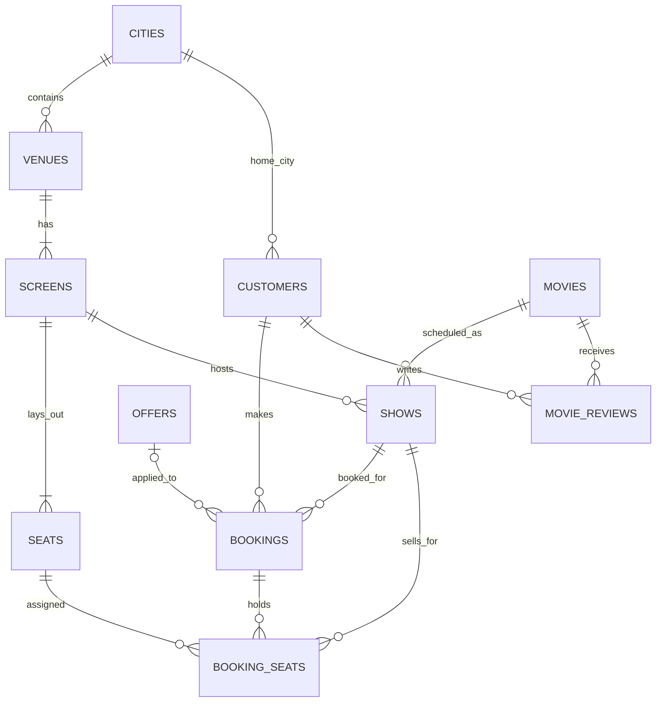

# Schema design and data dictionary

All tables live in schema `bms`. Types and constraints below are implemented in [`01_schema.sql`](../sql/01_schema.sql); CSV load commands and integrity queries are in [`02_load_data.sql`](../sql/02_load_data.sql). The database uses PostgreSQL 15+. `btree_gist` is enabled to express the no-overlap rule as a constraint.

## Data dictionary

| Table | Columns, types and rules | Purpose / rationale |
|---|---|---|
| `cities` | `city_id integer` PK; `city_name varchar(80)` NOT NULL UNIQUE; `state varchar(80)` NOT NULL | Venue/customer city lookup. |
| `venues` | `venue_id integer` PK; `venue_name varchar(120)` NOT NULL; `city_id integer` NOT NULL FK → cities (RESTRICT); `chain varchar(20)` NOT NULL CHECK; `address varchar(240)` NOT NULL | A cinema belongs to one city. Chain values are limited to the five present in the seed. |
| `screens` | `screen_id integer` PK; `venue_id integer` NOT NULL FK → venues (RESTRICT); `screen_name varchar(40)` NOT NULL; `screen_type varchar(12)` NOT NULL CHECK; `total_seats smallint` NOT NULL CHECK > 0; UNIQUE (`venue_id`,`screen_name`) | Screen naming is scoped to a venue; total capacity is retained for operational reports. |
| `seats` | `seat_id integer` PK; `screen_id integer` NOT NULL FK → screens (RESTRICT); `row_label char(1)` NOT NULL CHECK uppercase A–Z; `seat_number smallint` NOT NULL CHECK > 0; `seat_class varchar(10)` NOT NULL CHECK; UNIQUE (`screen_id`,`row_label`,`seat_number`) | Physical layout; seat numbers/rows repeat across screens. |
| `movies` | `movie_id integer` PK; `title varchar(160)` NOT NULL; `language varchar(20)` NOT NULL CHECK; `certificate varchar(2)` NOT NULL CHECK; `duration_min smallint` NOT NULL CHECK 1–600; `release_date date` NOT NULL | Movie catalogue attributes. |
| `shows` | `show_id integer` PK; `movie_id integer` NOT NULL FK → movies (RESTRICT); `screen_id integer` NOT NULL FK → screens (RESTRICT); `starts_at`, `ends_at timestamptz` NOT NULL; `format varchar(8)` NOT NULL CHECK; `base_price numeric(8,2)` NOT NULL CHECK ≥ 0; CHECK end > start; exclusion on screen and overlapping time range | One scheduled movie on one screen. The exclusion constraint prevents overlap and permits adjacent shows. |
| `customers` | `customer_id integer` PK; `full_name varchar(120)` NOT NULL; `email varchar(160)` NOT NULL UNIQUE; `phone varchar(15)` NOT NULL UNIQUE; `city_id integer` NOT NULL FK → cities (RESTRICT); `created_at timestamptz` NOT NULL | Unique email and phone support account identity and sign-in. |
| `offers` | `offer_code varchar(20)` PK; `description varchar(120)` NOT NULL; `discount_pct numeric(5,2)` NOT NULL CHECK 0–100; `max_discount numeric(8,2)` NOT NULL CHECK ≥ 0; `valid_from`, `valid_to date` NOT NULL; CHECK end date ≥ start date | Offer catalog; each offer code is a stable natural key. |
| `bookings` | `booking_id integer` PK; `booking_code char(10)` NOT NULL UNIQUE and format CHECK; `customer_id integer` NOT NULL FK → customers (RESTRICT); `show_id integer` NOT NULL FK → shows (RESTRICT); `booked_at timestamptz` NOT NULL; `num_tickets smallint` NOT NULL CHECK 1–10; `ticket_amount numeric(10,2)` NOT NULL CHECK ≥ 0; `convenience_fee numeric(8,2)` NOT NULL CHECK ≥ 0 and 10% of ticket amount; `fnb_amount numeric(8,2)` NOT NULL CHECK ≥ 0; `offer_code varchar(20)` nullable FK → offers (RESTRICT); `discount numeric(8,2)` NOT NULL CHECK ≥ 0 and no more than gross amount; `total_amount numeric(10,2)` NOT NULL CHECK ≥ 0 and equals ticket + fee + F&B − discount; `payment_method varchar(12)` NOT NULL CHECK; `status varchar(16)` NOT NULL CHECK | One checkout. An absent offer is a valid no-offer booking. Amount snapshots preserve what the customer was charged. |
| `booking_seats` | `booking_id integer` NOT NULL FK → bookings (CASCADE); `show_id integer` NOT NULL FK → shows (RESTRICT); `seat_id integer` NOT NULL FK → seats (RESTRICT); `price numeric(8,2)` NOT NULL CHECK ≥ 0; PK (`show_id`,`seat_id`) | One seat can be sold/held only once for a show. `show_id` is repeated from bookings deliberately to enforce this key and match the workload. |
| `movie_reviews` | `review_id integer` PK; `movie_id integer` NOT NULL FK → movies (RESTRICT); `customer_id integer` NOT NULL FK → customers (RESTRICT); `rating smallint` NOT NULL CHECK 1–10; `review_text text` nullable; `created_at timestamptz` NOT NULL | Rating can be submitted without written text. |

## Relationships and cardinalities

The resulting visual diagram is [`er_diagram.png`](../diagrams/er_diagram.png). `booking_seats` acts as a transaction bridge between bookings, shows and physical seats; its `(show_id, seat_id)` primary key enforces the one-seat-per-show rule. The seed alone does not provide a declarative FK ensuring a seat’s screen matches its show because `booking_seats` has no `screen_id`; the load integrity query checks this cross-table condition. The composite seat/show reference cannot be represented with the supplied columns without adding a redundant `screen_id` or a trigger.

## Constraints and automatically created indexes

In addition to the keys/FKs, checks restrict domain values for chain, screen type, seat class, language, certificate, show format, payment method and booking status; validate seat labels, positive ticket/capacity/duration values, ratings, date/time order, amount nonnegativity, booking-code shape, fee and total arithmetic. These are row-level rules (at least 20 CHECK constraints in the DDL). No workload-tuning indexes are added in this phase. PostgreSQL creates indexes for primary keys and unique constraints. The GiST index backing the show-overlap exclusion constraint is also mandatory constraint support, not a tuning index.

## Normal form and functional dependencies

Each table stores one fact per row with atomic values (1NF). The determinants below are the declared keys and determine the remaining non-key attributes; no non-key attribute determines another non-key attribute inside these relations, so each relation is in BCNF under the modeled dependencies (and therefore 3NF).

| Relation | Functional dependencies |
|---|---|
| cities | `city_id → city_name, state`; `city_name → city_id, state` (unique) |
| venues | `venue_id → venue_name, city_id, chain, address` |
| screens | `screen_id → venue_id, screen_name, screen_type, total_seats`; `(venue_id, screen_name) → screen_id, screen_type, total_seats` |
| seats | `seat_id → screen_id, row_label, seat_number, seat_class`; `(screen_id,row_label,seat_number) → seat_id, seat_class` |
| movies | `movie_id → title, language, certificate, duration_min, release_date` |
| shows | `show_id → movie_id, screen_id, starts_at, ends_at, format, base_price` |
| customers | `customer_id → full_name, email, phone, city_id, created_at`; `email → customer_id, …`; `phone → customer_id, …` |
| offers | `offer_code → description, discount_pct, max_discount, valid_from, valid_to` |
| bookings | `booking_id → booking_code, customer_id, show_id, booked_at, num_tickets, amounts, offer_code, payment_method, status`; `booking_code → booking_id, …` |
| booking_seats | `(show_id,seat_id) → booking_id, price` (and supplied `booking_id, show_id, seat_id` identifies a row) |
| movie_reviews | `review_id → movie_id, customer_id, rating, review_text, created_at` |

### Derived and intentionally retained values

- `screens.total_seats` can be counted from `seats`; it remains as a capacity snapshot used by occupancy workload queries. A trigger would be needed to guarantee it always equals the layout count.
- `bookings.ticket_amount` overlaps the sum of seat prices, while the booking amount fields are checkout snapshots. Keeping them avoids recalculating historical totals and supports finance reports. No check equates them to seat prices because pending bookings may have incomplete seat rows and prices may be changed later.
- `booking_seats.show_id` can be reached through `bookings.show_id`; it is retained because the workload addresses seats by show and the composite primary key prevents double-selling. A cross-column FK/check would require a schema change or trigger.
- `shows.ends_at` is not derived from `movies.duration_min`; operational padding and schedule adjustments make the stored end timestamp authoritative.

## Seed data findings and integrity checks

Empty `offer_code` appears on 127,659 bookings and represents no applied offer; it is NULL-able. Empty `review_text` appears on 16,162 reviews and represents rating-only reviews; it is NULL-able. The sample has 150,094 bookings, including 10 pending, 8,910 cancelled and 7,606 payment-failed. Cancelled and failed bookings have no `booking_seats` rows; confirmed bookings each have exactly their `num_tickets` seat rows. Pending checkouts are allowed to be incomplete. The CSVs contain no recorded invalid dates, out-of-domain codes, duplicate natural keys or overlapping shows.

| Check | Result from the supplied CSVs |
|---|---:|
| cities / venues / screens / seats / movies / shows | 10 / 140 / 490 / 94,056 / 300 / 160,034 |
| customers / offers / bookings / booking_seats / movie_reviews | 40,000 / 25 / 150,094 / 300,389 / 32,510 |
| Booking total formula mismatch count | 0 |
| Convenience fee (10% of ticket amount) mismatch count | 0 |
| Confirmed bookings whose seat count differs from `num_tickets` | 0 |
| Cancelled or payment-failed bookings with held seats | 0 |
| Screens whose `total_seats` differs from their seat layout count | 0 |
| Booked seats whose physical screen differs from their show screen | 0 |
| Overlapping shows on the same screen | 0 |

The CSV checks were computed directly against the provided seed files. The workspace does not have a running PostgreSQL server (`pg_isready` reports no response on the local default socket), so a live `psql` import and SQL result capture could not be performed here. The load script includes expected row-count output and executable SQL checks for running against PostgreSQL; an actual database load remains to be confirmed in an environment with a server.